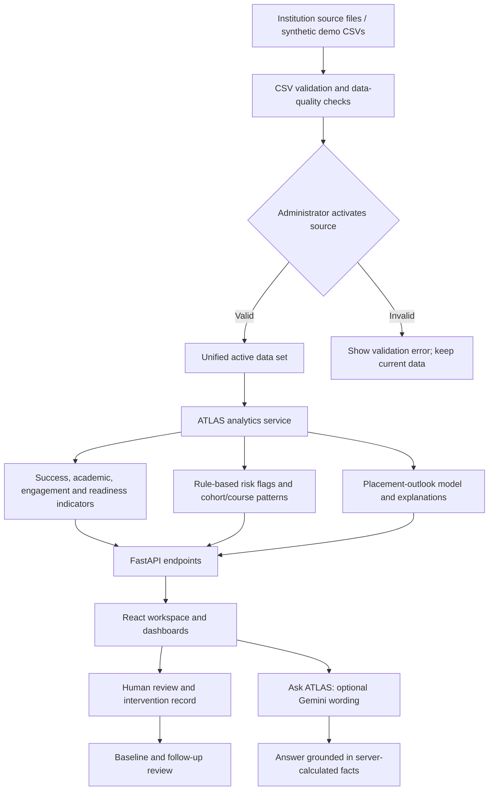
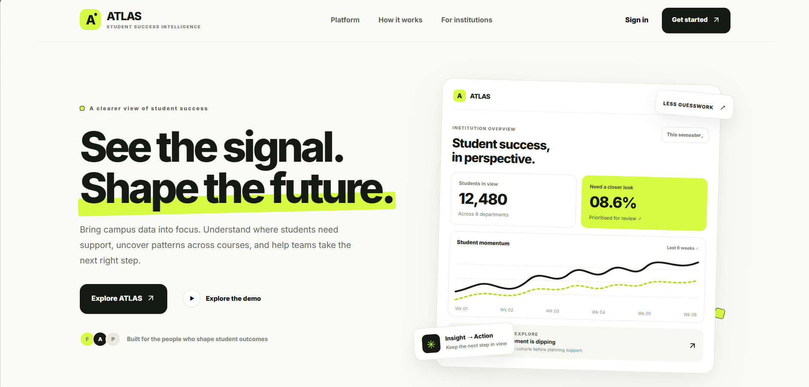
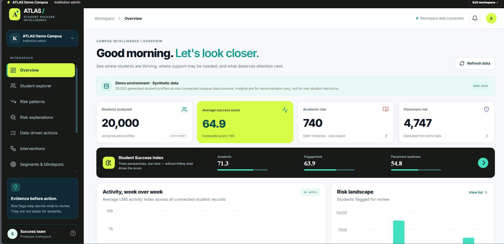
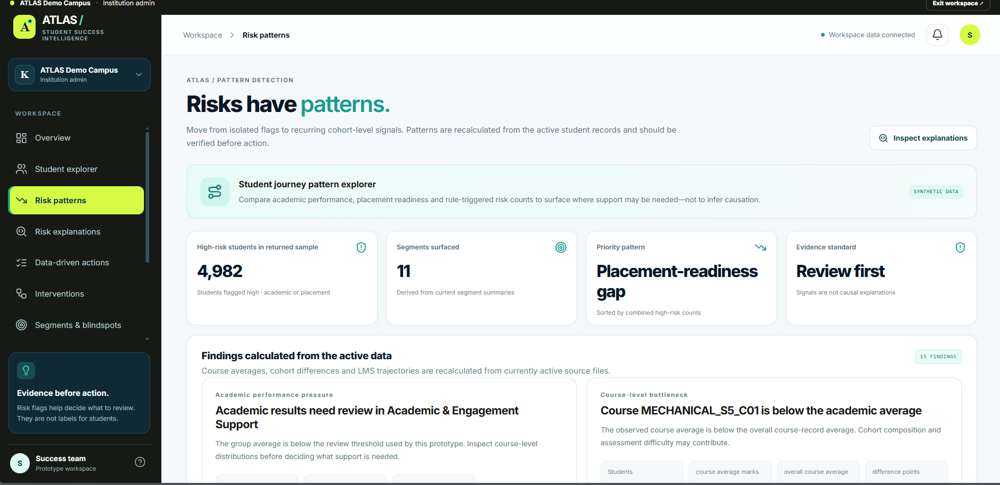

<div align="center">

# ATLAS
### Student Success Intelligence

**Turn disconnected campus records into clear priorities for student support.**

A campus analytics prototype for academic performance, engagement, placement readiness and evidence-led intervention planning.


[Challenge](#1-the-challenge) · [Solution](#2-the-solution) · [Architecture](#5-how-it-works) · [Features](#6-key-features) · [Run locally](#10-run-atlas-locally) · [API](#12-api-reference)


</div>

---

## 1. The challenge

Colleges hold useful student information across separate systems: student records, course marks, attendance, learning-platform activity, support requests and placement preparation. When those records are reviewed separately or only at the end of a term, teams can struggle to answer practical questions in time:

- Which courses or student groups need a closer review?
- Where do academic results, engagement and placement readiness tell different stories?
- What evidence supports a risk flag-and what should staff check next?
- Did an intervention lead to a measurable change?
- When a source file is refreshed, which campus indicators change?

A dashboard full of scores is not enough. Staff need traceable evidence, clear language and a workflow that keeps people responsible for decisions.

## 2. The solution

**ATLAS brings campus indicators into one review workspace.** It combines the bundled data sources into a unified student-level view, calculates transparent indicators, detects patterns that deserve attention and helps staff record follow-up actions.

ATLAS is designed to support - not replace-faculty, mentors, placement teams and institutional administrators. A flag is a prompt to investigate, not a label for a student or proof of cause.

### Typical workflow

1. **Connect the evidence** - start with the included synthetic data or validate a compatible CSV source.
2. **Check data quality** - review required columns, row counts and student-ID matching before activation.
3. **Review the campus** - inspect the overview, student explorer, course/cohort patterns and readiness gaps.
4. **Understand the signal** - open a student or segment explanation and review the supporting indicators.
5. **Plan a response** - record an owner, action, baseline, follow-up measure and due date.
6. **Review the result** - compare the next observation with the recorded baseline.

## 3. Who it is for

| User | What ATLAS helps them do |
|---|---|
| Institution administrator | Review campus-level indicators, manage approved data imports and keep the active data set current. |
| Faculty / course coordinator | Identify course-level differences and check assessment, attendance and learning activity before choosing support. |
| Mentor / student-support team | Review a student's current indicators and record a follow-up plan. |
| Placement team | Find cohorts where academic scores and placement-readiness measures differ, then target verified skill practice. |
| Institutional leadership | Review summary trends, data quality and documented actions without treating a score as a final judgement. |

## 4. What makes ATLAS different

### Evidence before action
Every pattern is paired with the measures that triggered it, a cautious interpretation and a suggested human review. Staff can inspect the evidence instead of relying on an unexplained risk label.

### One view across separate sources
The prototype combines academic records, LMS activity, engagement, placement preparation, feedback and student master records into a common analytical view.

### Rules and model outputs have distinct jobs
Academic risk flags use explicit rules. A Logistic Regression pipeline estimates placement outlook from the configured feature set. ATLAS also exposes model metrics and explanation endpoints so the model output can be inspected. 

### New data can change the findings
Validated CSVs can be staged and activated. Activation rebuilds the in-memory analytics store, so data-dependent counts and patterns can change with the active data. A CSV import does not automatically retrain the placement model.

### AI writing is optional, not the source of truth
Ask ATLAS can use Gemini to phrase a response from server-calculated facts. The application computes the figures; Gemini does not own the metrics. If Gemini is not configured or a request fails, a deterministic summary is returned instead.

### A record of follow-through
Intervention records capture an action, owner, status, baseline measure and follow-up measure. This makes it possible to review whether a support action was completed and what changed afterward.

## 5. How it works



### Important implementation boundaries

- **Frontend:** React renders the workspace and calls the backend; it is not the authority for analytical calculations.
- **Backend:** FastAPI validates requests, loads active data and serves calculated results.
- **Analytics:** pandas-based transformations combine sources and calculate scores, segments and patterns.
- **Placement outlook:** a bundled scikit-learn Logistic Regression pipeline; explanations and model metrics are exposed separately.
- **Persistence:** SQLite stores intervention records in a local single-instance setup. Active CSVs are file-backed.
- **Optional writing:** Gemini receives a constrained set of server-computed facts. The API key stays on the backend.

## 6. Key features

| Feature | What it does | Why it matters |
|---|---|---|
| Campus overview | Summarises student count, success score, academic risk and placement risk. | Gives teams a starting point for review. |
| Student explorer | Supports student-level lookup and inspection of calculated indicators. | Moves from campus totals to a specific record when authorised. |
| Risk patterns | Surfaces course bottlenecks, academic pressure, engagement differences and placement-readiness gaps. | Shows where a deeper review may be useful. |
| Risk explanations | Returns evidence behind the current academic or placement signal. | Makes it easier to challenge or verify a flag. |
| Student segments | Groups records with similar observed indicators. | Helps staff plan support for a cohort without assuming every student has the same needs. |
| Data sources | Lists available CSV sources and their validation requirements. | Makes data readiness visible. |
| Data quality | Reports issues found in the active source set. | Reduces the chance of acting on incomplete or mismatched data. |
| Ask ATLAS | Answers a natural-language question using facts selected by backend logic. | Helps users explore the current data in plain language. |
| Intervention tracking | Stores action, owner, status and before/after measures. | Connects an observation to a reviewable next step. |
| Decision reports | Generates a risk snapshot or institutional brief. | Helps communicate findings to staff. |

## 7. Technology choices

| Technology | Role in ATLAS | Reason for choosing it |
|---|---|---|
| **Python 3.12** | Backend runtime | Mature data and machine-learning ecosystem; compatible with the intended current dependency set. |
| **FastAPI** | HTTP API | Clear endpoint definitions, request validation and interactive API documentation. |
| **pandas** | Data loading and analytics | Practical for joining, validating and aggregating institution-style CSV data. |
| **scikit-learn** | Placement-outlook pipeline | Provides a straightforward, inspectable baseline model that is lightweight for a demo. |
| **SHAP** | Optional feature-attribution endpoint | Helps explain a model output where supported; kept distinct from the separate non-SHAP contribution explanation. |
| **SQLite** | Intervention persistence | Simple local persistence without requiring a separate database service for the MVP. |
| **React** | User interface | Component-based screens for dashboards, patterns and workflows. |
| **Vite** | Frontend development/build | Fast local feedback and a straightforward production build. |
| **Recharts** | Charts | Integrates chart components into the React interface. |
| **Gemini API (optional)** | Wording for Ask ATLAS | Can turn selected, verified facts into a concise explanation; not used to calculate official metrics. |
| **Docker Compose** | Optional local container run | Provides a repeatable way to launch the frontend and backend together. |

## 8. Screenshots

### ATLAS 


### Campus overview

The overview brings campus-wide indicators and the risk landscape into one place. The figures in the bundled demo are synthetic.



### Risk patterns

Pattern cards show the affected group size, observed measures and a suggested review action. These are prompts for investigation, not causal conclusions.




## 9. Repository structure

```text
kpmg_student_success_platform/
├── backend/
│   ├── app/
│   │   ├── main.py                    # FastAPI app, routes, auth and API orchestration
│   │   └── services/
│   │       ├── analytics.py           # Source adapters, scores, segments and patterns
│   │       └── atlas_model_pipeline.py # Placement model feature/explanation helpers
│   ├── models/
│   │   ├── atlas_placement_logistic_pipeline.joblib
│   │   └── placement_model_metrics.json
│   ├── tests/                         # API and behaviour tests
│   ├── .env.example                   # Backend configuration template
│   ├── requirements.txt
│   └── Dockerfile
├── frontend/
│   ├── src/
│   │   ├── App.jsx                    # Workspace screens and interactions
│   │   └── styles.css                 # ATLAS visual system
│   ├── .env.example
│   ├── package.json
│   └── Dockerfile
├── data/                              # Synthetic CSV sources and data dictionary
├── resources/                         # Dataset notes and model baseline notebook
├── scripts/                           # Model training/build utilities
├── docs/screenshots/                  # README product screenshots
├── staging/                           # Validated uploads waiting for activation
├── docker-compose.yml
└── README.md
```

## 10. Run ATLAS locally

### Prerequisites

- Windows, macOS or Linux
- **Python 3.12** recommended for this bundled environment
- Node.js and npm
- Internet access for dependency installation; a Gemini key is optional

### Step 1 - Create the Python environment

Run these commands from the repository root. The virtual environment is created locally and is not part of the ZIP.

**Windows (Command Prompt):**

```bat
py -3.12 -m venv .venv
.venv\Scripts\python.exe -m pip install --upgrade pip
.venv\Scripts\python.exe -m pip install -r backend\requirements.txt
```

**macOS / Linux:**

```bash
python3.12 -m venv .venv
.venv/bin/python -m pip install --upgrade pip
.venv/bin/python -m pip install -r backend/requirements.txt
```

### Step 2 - Configure the backend

Copy `backend/.env.example` to `backend/.env`. Update the administrator password before sharing the app. The sample values below are for local evaluation only.

```dotenv
ATLAS_ADMIN_EMAIL=admin@atlas.demo
ATLAS_ADMIN_PASSWORD=AtlasDemo@2026
ATLAS_ADMIN_INSTITUTION=ATLAS Demo Campus
DEMO_READ_ONLY=false
MAX_UPLOAD_MB=100
GEMINI_API_KEY=
CORS_ORIGINS=http://localhost:5173,http://127.0.0.1:5173
ATLAS_DB_PATH=../atlas_state.sqlite3
```

- `GEMINI_API_KEY` is optional. Leave it blank to use deterministic ATLAS summaries.
- To enable Ask ATLAS written summaries, create a key in [Google AI Studio](https://aistudio.google.com/apikey) and place it only in `backend/.env`.
- Set `DEMO_READ_ONLY=true` to disable upload/activation and intervention writes intended for a public read-only demonstration.
- Do not commit `backend/.env`, share a real API key, or use the sample password outside a local demo.

### Step 3 - Start the backend

Open a terminal at the repository root:

```bat
cd backend
..\.venv\Scripts\python.exe -m uvicorn app.main:app --reload --host 127.0.0.1 --port 8000
```

On macOS/Linux, from `backend/` run:

```bash
../.venv/bin/python -m uvicorn app.main:app --reload --host 127.0.0.1 --port 8000
```

Check `http://127.0.0.1:8000/api/health`. Interactive endpoint documentation is available at `http://127.0.0.1:8000/docs`.

### Step 4 - Start the frontend

Open a second terminal:

```bash
cd frontend
npm install
npm run dev
```

Open the local URL printed by Vite - normally `http://localhost:5173`.

If the backend runs at a different address, set `VITE_API_URL` in `frontend/.env` using `frontend/.env.example` as a template, then restart Vite.

### Sample demo sign-in

| Field | Local demo value |
|---|---|
| Institution | `ATLAS Demo Campus` |
| Email | `admin@atlas.demo` |
| Password | `AtlasDemo@2026` |

These credentials are intentionally visible for evaluator access. Change them in `backend/.env` before distributing the application. This is a single-account local demo identity, not a full production identity provider.

## 11. Uploading and refreshing data

The prototype recognises these source files:

| File | Purpose |
|---|---|
| `student_master.csv` | Student identity keys and programme context |
| `academic_course_records.csv` | Marks, course attendance, assignment scores and backlog flags |
| `lms_weekly_activity.csv` | Weekly learning activity and assignment completion |
| `engagement_summary.csv` | Events, projects, certifications and engagement indicators |
| `placement_preparation_activity.csv` | Aptitude, coding, mock interview and related preparation measures |
| `student_feedback.csv` | Feedback and support-request indicators |
| `course_catalog.csv` | Course metadata |
| `placement_outcomes.csv` | Synthetic target labels for the demo placement model |

Recommended workflow:

1. Use **Data sources** to select the source that the CSV is meant to replace.
2. Upload a `.csv` file with the required schema shown by the API/UI.
3. Review validation results, row count and student-ID join diagnostics.
4. Activate the staged source and check the returned before/after analytics snapshot.
5. Revisit Overview, Risk patterns, Student explorer and Segments to confirm that the active data changed as expected.

**Important:** An upload is not the same as activation. Data that fails validation should not replace the active source. For meaningful changes, update a field that is used in the relevant metric. The placement model is not automatically retrained when CSVs are uploaded.

### Data and model cautions

- Bundled data is synthetic; displayed counts and model metrics are not claims about a real institution.
- Student IDs must join across relevant files. A source with no matching IDs cannot provide meaningful student-level updates.
- Missing values are not proof of poor performance. Review data coverage and data-quality warnings.
- Risk thresholds are prototype rules and require institutional review.
- The placement model's labels are synthetic. Evaluate calibration, leakage, subgroup performance and usefulness against authorised historical outcomes before considering operational use.

## 12. API reference

Base URL for local development: `http://127.0.0.1:8000`

Full request and response schemas are available in Swagger UI at [`/docs`](http://127.0.0.1:8000/docs). The table below summarises the current application routes.

### Authentication

| Method | Endpoint | Purpose | Access / notes |
|---|---|---|---|
| `POST` | `/api/auth/login` | Verify demo administrator email and password; returns a session token and user details. | JSON body: `email`, `password`, optional `institution`. |
| `POST` | `/api/auth/logout` | Remove the supplied session token from the in-memory session store. | JSON body: `{"access_token":"..."}`. |
| `GET` | `/api/health` | Basic service health check. | Public. |

For protected source upload and per-source sync requests, send the session token in the `X-Atlas-Session` header. The current demo stores sessions in process memory, so restarting the backend clears them.

### Sources and data quality

| Method | Endpoint | Purpose |
|---|---|---|
| `GET` | `/api/sources` | List known source files, expected columns, source status and staged-upload details. |
| `POST` | `/api/sources/{filename}/upload` | Validate and stage a CSV upload. Requires `X-Atlas-Session` administrator token. |
| `POST` | `/api/sources/{filename}/sync` | Activate a staged source or refresh a source. Requires `X-Atlas-Session` administrator token. |
| `POST` | `/api/sources/sync-all` | Validate and refresh all sources; activates staged files together when present. **Current implementation note:** add administrator-session enforcement here before exposing this route beyond a trusted local demo. |
| `GET` | `/api/data-quality` | Return data-quality findings for active data. |

### Analytics and student review

| Method | Endpoint | Purpose |
|---|---|---|
| `GET` | `/api/overview` | Campus overview indicators. |
| `GET` | `/api/branches` | Branch-level summary. |
| `GET` | `/api/segments` | Current student segments. |
| `GET` | `/api/students` | Student list/search and filters supported by query parameters. |
| `GET` | `/api/students/{student_id}` | Detail for one student. |
| `GET` | `/api/students/{student_id}/placement-explanation` | Placement-model contribution explanation; this is not a SHAP explanation. |
| `GET` | `/api/students/{student_id}/shap-explanation` | SHAP-based explanation where supported by the configured pipeline. |
| `GET` | `/api/cohorts` | Cohort-level summary. |
| `GET` | `/api/patterns` | Calculated current course, cohort and segment patterns. |
| `GET` | `/api/blindspots` | Calculated blindspot detectors and supporting counts. |
| `GET` | `/api/model-metrics` | Bundled placement model evaluation metrics. |
| `GET` | `/api/score-method` | Score formulas, rule thresholds and model caveats. |

### Questions, reports and interventions

| Method | Endpoint | Purpose | Notes |
|---|---|---|---|
| `POST` | `/api/ai/ask` | Answer a natural-language question from server-selected facts. | Gemini is optional; fallback is deterministic. |
| `POST` | `/api/reports/generate` | Generate a risk snapshot or institutional brief. | Request `report_type` and optional `branch`. |
| `GET` | `/api/interventions` | List intervention records; supports optional `student_id` and `status` filters. | Returns SQLite-backed records. |
| `POST` | `/api/interventions` | Create an intervention record. | Disabled when `DEMO_READ_ONLY=true`. |
| `PATCH` | `/api/interventions/{intervention_id}` | Update an intervention record. | Disabled when `DEMO_READ_ONLY=true`. |

Example login request:

```bash
curl -X POST http://127.0.0.1:8000/api/auth/login \
  -H "Content-Type: application/json" \
  -d '{"email":"admin@atlas.demo","password":"AtlasDemo@2026","institution":"ATLAS Demo Campus"}'
```

Example Ask ATLAS request:

```bash
curl -X POST http://127.0.0.1:8000/api/ai/ask \
  -H "Content-Type: application/json" \
  -d '{"question":"Which current patterns deserve attention, and what evidence supports them?"}'
```

## 13. MVP scope and evaluation checklist

The current MVP demonstrates the end-to-end path from source data to reviewable institutional action.

- [x] Unified analysis of the included synthetic source files
- [x] Campus overview and student-level exploration
- [x] Rule-based academic risk indicators
- [x] Placement-outlook baseline model and model metrics endpoint
- [x] Course, cohort, engagement and placement-readiness patterns
- [x] Evidence-oriented explanation endpoints
- [x] CSV schema validation and staged activation workflow
- [x] Ask ATLAS with optional Gemini wording and deterministic fallback
- [x] Intervention records with baseline and follow-up measures
- [x] Local demo administrator sign-in
- [ ] Production identity provider, secure persistent sessions and account lifecycle
- [ ] Complete authorization on every write/activation endpoint
- [ ] Institution-level data isolation and permission model
- [ ] Validated performance on authorised, representative institutional data
- [ ] Production audit logging, retention controls and monitoring

### Suggested evaluator walkthrough

1. Sign in with the demo credentials.
2. Review the overview and note that the data is synthetic.
3. Open Risk patterns and inspect the evidence and suggested next step for a course or segment.
4. Open a student record and compare the indicators with the explanation endpoint.
5. Ask ATLAS a question and check that numeric claims match returned `facts`.
6. Review Data quality and the expected columns for a source.
7. In a writable local demo, stage a compatible CSV, review validation, activate it and compare before/after values.
8. Create an intervention with a baseline, owner and follow-up measure; revisit it to review status.

## 14. Roadmap

### Next - harden the demo

- Protect every source activation route and every intervention write with explicit authorization.
- Replace process-memory tokens with expiring, revocable sessions and a production identity provider.
- Render generated Markdown safely and handle empty, truncated and failed writing-service responses visibly.
- Add automated integration tests for login, role checks, source upload/activation and changed-data behaviour.

### Then - validate the analytics

- Establish a documented data dictionary and source ownership for each connected system.
- Evaluate the placement model on authorised historical data using time-aware validation, calibration and subgroup checks.
- Review score thresholds with academic, student-support and placement stakeholders.
- Add drift checks and model/data version metadata to reports.

### Later - institutional deployment

- Build secure connectors for student information systems, learning platforms and placement systems.
- Move source files and intervention records to managed storage/database infrastructure with backups.
- Add institution tenancy, role-based permissions, audit trails, retention controls and consent/governance workflows.
- Add intervention outcome reporting and controlled comparisons where the study design supports them.
- Add deployment monitoring, accessibility testing and a documented incident-response process.

## 15. Team

**Team name:** _MESSI VERSE_


| Member | Name | 
|---|---|
| 1 | `Vignesh ` | 
| 2 | `Sowmya` |
| 3 | `Nagarupa` | 
| 4 | `Akanksha` | 
| 5 | `Vijay` |


## 16. Tests and build checks

From the repository root, install the dependencies as described above. Then:

**Backend tests (Windows):**

```bat
cd backend
set PYTHONPATH=.
..\.venv\Scripts\python.exe -m pytest -q
```

**Frontend production build:**

```bash
cd frontend
npm install
npm run build
```

**API documentation:** `http://127.0.0.1:8000/docs`

## 17. Responsible-use and security notes

ATLAS is a hackathon MVP. Before any real institutional deployment:

- Do not use the bundled sample credentials or synthetic-trained model for operational decisions.
- Implement persistent, expiring sessions; password hashing/account lifecycle; CSRF protections if cookie-based sessions are introduced; rate limiting; and secure secret management.
- Enforce authentication and role authorization on every source activation, report and intervention write route—not only the upload screen.
- Implement institution-level isolation, least-privilege access, audit trails, retention/deletion policy and encrypted transport/storage.
- Obtain institutional approval and validate lawful use, data quality, model performance and subgroup impacts before processing student records.
- Treat risk signals as prompts for a human review. Do not use them as the sole basis for denying opportunities or applying penalties.

## License and attribution
MIT

---

<div align="center">

**ATLAS - Evidence before action.**

A review workspace for better questions, clearer evidence and more accountable follow-through.

</div>
